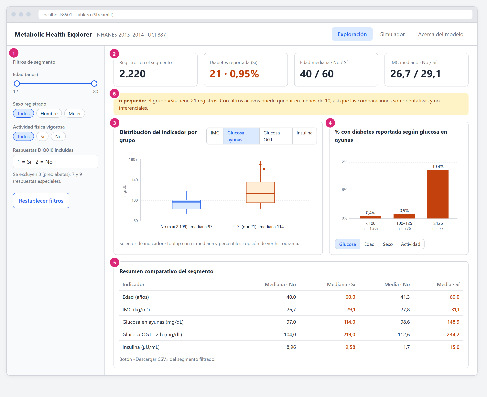
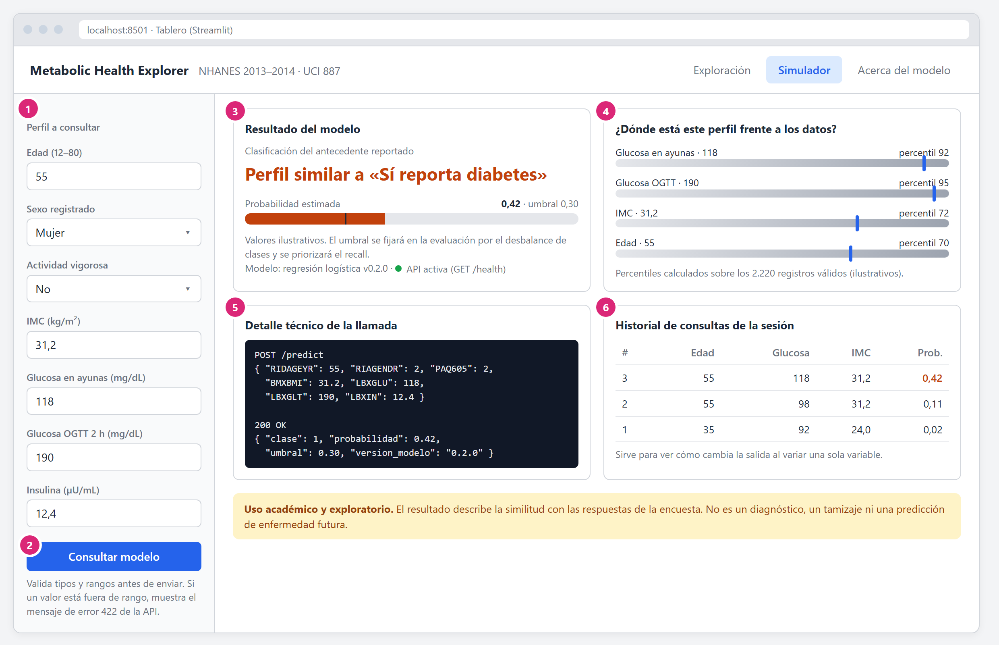
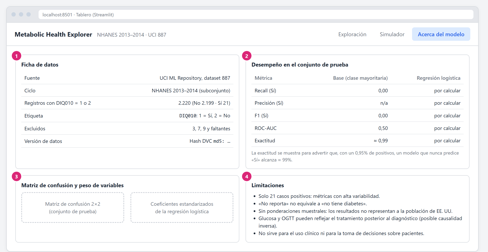
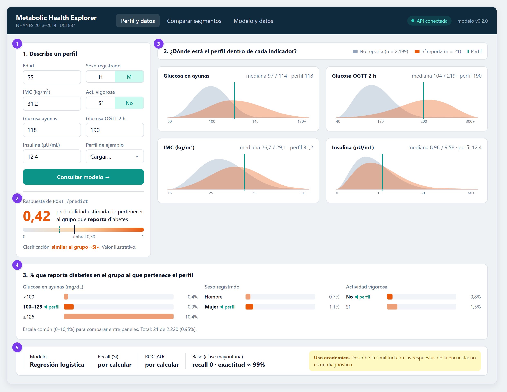
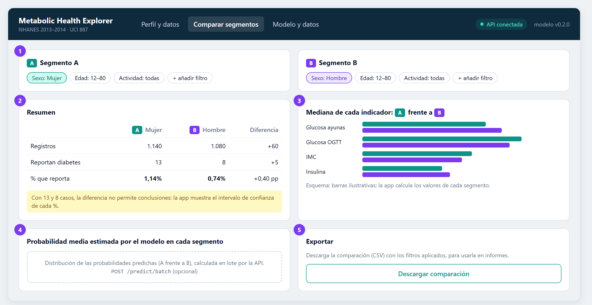
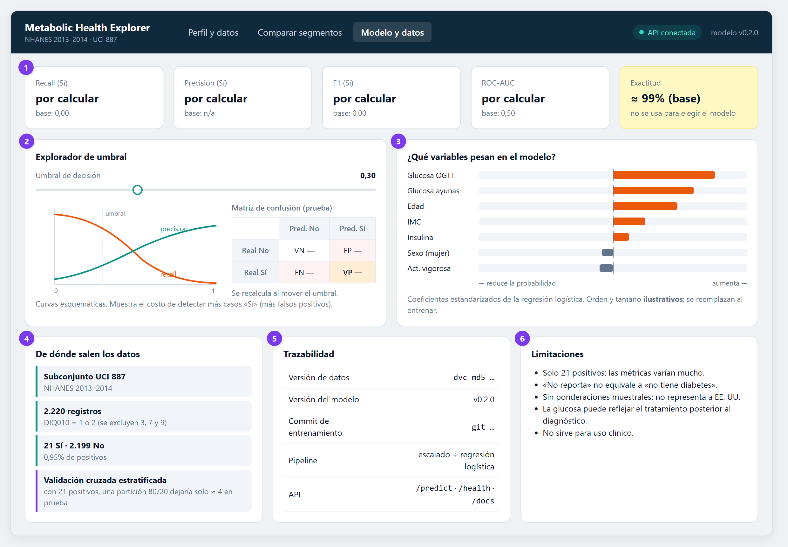
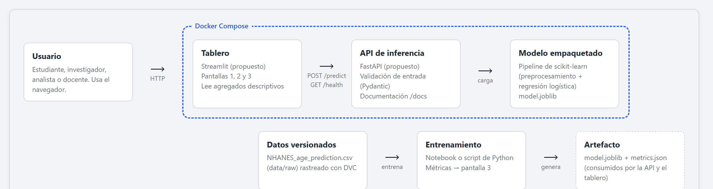

# 4. Maqueta (mockup) del prototipo

**Proyecto:** Metabolic Health Explorer  
**Asignatura:** Despliegue de Soluciones Analíticas, MIAD  
**Estado:** Maquetas iniciales de baja fidelidad (Entrega 1); dos alternativas

## 4.1 Propósito de la maqueta

La maqueta representa el tablero que usará el usuario final y su relación con la API de inferencia. Cada elemento se diseñó para responder a la pregunta de negocio definida en [`02_pregunta_de_negocio_y_alcance.md`](02_pregunta_de_negocio_y_alcance.md):

> ¿Cómo facilitar la identificación y exploración de patrones en indicadores metabólicos y características demográficas asociados con el antecedente de diabetes reportada en el subconjunto NHANES 2013–2014, mediante una aplicación interactiva que integre análisis descriptivo y clasificación supervisada?

y a las preguntas de apoyo:

| Código | Pregunta de apoyo |
|---|---|
| P1 | ¿Cómo se distribuyen el IMC, la glucosa y la insulina entre quienes reportan y no reportan diabetes? |
| P2 | ¿Qué diferencias se observan al segmentar por edad, sexo y actividad física? |
| P3 | ¿Qué capacidad tienen las variables para distinguir la respuesta mediante un clasificador sencillo? |
| P4 | ¿Cómo presentar comparaciones e inferencias de forma reproducible y comprensible? |

Se elaboraron **dos alternativas**. Ambas cubren los tres módulos del alcance funcional (sección 2.5): A (descriptivo), B (predictivo, vía API) y C (transparencia).

- **Opción A, por pestañas:** cada módulo en su propia pantalla, con filtros en una barra lateral.
- **Opción B, centrada en el perfil:** el usuario ingresa un perfil y todo el tablero se lee respecto a él. Incluye además una pantalla para comparar segmentos.

**Origen de las cifras.** Los conteos, medianas, medias y tasas por categoría provienen del análisis exploratorio sobre los 2.220 registros con `DIQ010` = 1 o 2. Las curvas y diagramas de caja son esquemáticos. Las probabilidades, percentiles y coeficientes son **ilustrativos**, y las métricas del modelo aparecen como *por calcular*, ya que el modelo se entrenará en la siguiente fase.

**Archivos fuente.** Las maquetas son HTML editables: [`mockup/maqueta_prototipo.html`](mockup/maqueta_prototipo.html) (opción A) y [`mockup/opcion_b/maqueta_opcion_b.html`](mockup/opcion_b/maqueta_opcion_b.html) (opción B). Si se añade al final de la URL `#p1`, `#p2`, `#p3`, `#arq` (A) o `#b1`, `#b2`, `#b3` (B), se muestra solo esa pantalla.

## 4.2 Opción A: tablero por pestañas

### Pantalla A1: Exploración descriptiva (Módulo A)

| # | Elemento | Qué hace | Relación con la pregunta |
|---|---|---|---|
| 1 | Filtros de segmento | Rango de edad, sexo registrado y actividad vigorosa (`PAQ605`). Deja explícita la recodificación de `DIQ010` (se excluyen 3, 7 y 9). | P2 |
| 2 | Indicadores clave | Tamaño del segmento, casos «Sí» (21; 0,95%) y medianas de edad e IMC por grupo. | Contexto y desbalance de clases |
| 3 | Distribución por indicador | Diagrama de caja o histograma de IMC, glucosa en ayunas, OGTT e insulina por grupo. | P1 |
| 4 | Tasa por categoría | % con diabetes reportada por categoría de glucosa (0,4% / 0,9% / 10,4%), edad, sexo o actividad. | P1, P2 |
| 5 | Tabla comparativa | Medianas y medias por grupo; descarga en CSV. | P1, P4 |
| 6 | Aviso de tamaño muestral | Se muestra cuando el grupo «Sí» del segmento es pequeño. | P4 |

### Pantalla A2: Simulador de clasificación (Módulo B)

| # | Elemento | Qué hace | Relación con la pregunta |
|---|---|---|---|
| 1 | Formulario de entrada | Las 7 variables candidatas, con validación de tipos, rangos y categorías. | P3 |
| 2 | Botón «Consultar modelo» | Envía el JSON a `POST /predict` y muestra los errores de validación (422). | Criterio de éxito 4: el tablero usa el modelo **solo** vía API |
| 3 | Resultado | Clase, probabilidad, umbral de decisión, versión del modelo y estado de `GET /health`. | P3 |
| 4 | Ubicación del perfil | Percentil de cada valor ingresado frente al conjunto de datos. | Une lo descriptivo (P1) con lo predictivo (P3) |
| 5 | Detalle técnico | Petición y respuesta JSON (sección desplegable). | P4; usuario docente o técnico |
| 6 | Historial de la sesión | Permite comparar escenarios cambiando una sola variable. | P3 |

### Pantalla A3: Acerca del modelo y de los datos (Módulo C)

| # | Elemento | Qué hace | Relación con la pregunta |
|---|---|---|---|
| 1 | Ficha de datos | Fuente, ciclo, filtrado de `DIQ010` y versión de datos en DVC. | Criterio de éxito 1 (reproducibilidad), P4 |
| 2 | Métricas frente al modelo base | Recall, precisión, F1 y ROC-AUC frente al clasificador de clase mayoritaria. | P3 |
| 3 | Matriz de confusión y coeficientes | Errores por clase y peso de cada variable en la regresión logística. | P3, P1 |
| 4 | Limitaciones | Advertencias de interpretación y uso. | Sección 2.8 y criterio de éxito 6 |

## 4.3 Opción B: tablero centrado en el perfil

### Pantalla B1: Perfil frente a los datos (Módulos A y B integrados)

| # | Elemento | Qué hace | Relación con la pregunta |
|---|---|---|---|
| 1 | Formulario de perfil | Las 7 variables candidatas, con perfiles de ejemplo precargados. | P3 |
| 2 | Resultado del modelo | Probabilidad en una escala continua con el umbral marcado; respuesta de `POST /predict`. | P3; criterio de éxito 4 |
| 3 | Distribuciones con el perfil marcado | Curvas No/Sí de cada indicador con una línea en el valor ingresado. | P1 |
| 4 | Tasas por categoría | % que reporta diabetes por glucosa, sexo (0,7% / 1,1%) y actividad (0,8% / 1,5%), con el grupo del perfil resaltado. | P2 |
| 5 | Franja del modelo | Métricas clave frente al modelo base y aviso de uso. | P3, P4 |

### Pantalla B2: Comparar segmentos (Módulo A)

| # | Elemento | Qué hace | Relación con la pregunta |
|---|---|---|---|
| 1 | Definición de segmentos A y B | Filtros independientes de edad, sexo y actividad para cada segmento. | P2 |
| 2 | Resumen comparativo | Registros, casos y % que reporta, con la diferencia y la advertencia de n pequeño (ejemplo real: mujeres 13/1.140 frente a hombres 8/1.080). | P2, P4 |
| 3 | Medianas por indicador | Barras pareadas A/B por indicador metabólico. | P1 |
| 4 | Predicción por segmento | Distribución de las probabilidades del modelo en cada segmento (endpoint opcional `POST /predict/batch`). | P3 |
| 5 | Exportar | Descarga de la comparación en CSV. | P4 |

### Pantalla B3: Modelo y datos (Módulo C)

| # | Elemento | Qué hace | Relación con la pregunta |
|---|---|---|---|
| 1 | Métricas frente al modelo base | Recall, precisión, F1 y ROC-AUC; la exactitud (≈ 99% del modelo base) se muestra como advertencia. | P3 |
| 2 | Explorador de umbral | Al mover el umbral se ven el balance entre recall y precisión y la matriz de confusión. | P3, P4 |
| 3 | Peso de las variables | Coeficientes estandarizados de la regresión logística, con su signo. | P1, P3 |
| 4 | Origen y evaluación de los datos | Recorrido desde el subconjunto UCI hasta los datos de evaluación. | Criterio de éxito 1; riesgo de la sección 2.10 |
| 5 | Trazabilidad | Versiones de los datos (DVC), del modelo y del código; endpoints de la API. | Criterios de éxito 1, 2 y 3 |
| 6 | Limitaciones | Advertencias de interpretación y uso. | Sección 2.8 y criterio de éxito 6 |

## 4.4 Comparación de las opciones

| Criterio | Opción A: por pestañas | Opción B: centrada en el perfil |
|---|---|---|
| Relación descriptivo–predictivo | Pantallas separadas; la conexión es el panel de percentiles (A2.4) | Integrada: el perfil aparece en cada gráfica (B1) |
| Segmentación (P2) | Filtros globales en la barra lateral | Pantalla dedicada que compara dos segmentos (B2) |
| Explicación del desbalance | Avisos y tabla de métricas | Además, explorador de umbral interactivo (B3.2) |
| Complejidad de implementación | Menor: estructura nativa de Streamlit (barra lateral + pestañas) | Mayor: estado compartido entre gráficas y endpoint por lotes opcional |
| Usuario que más se beneficia | Analista que explora la muestra | Docente o estudiante que quiere entender el modelo |

## 4.5 Arquitectura y flujo

1. El usuario interactúa con el **tablero** (Streamlit, propuesto) desde el navegador.
2. Las vistas descriptivas leen agregados del conjunto de datos y las métricas guardadas (`metrics.json`). El simulador llama a la **API** (FastAPI, propuesta) mediante `POST /predict` y `GET /health`.
3. La API carga el **pipeline de scikit-learn** serializado (`model.joblib`), que incluye el preprocesamiento y el modelo.
4. El modelo se entrena a partir de los datos versionados con **DVC**.
5. El tablero y la API se ejecutan en contenedores separados, orquestados con **Docker Compose**.

La arquitectura es la misma para ambas opciones; solo cambia la organización de las pantallas.

## 4.6 Decisiones de diseño

- **Hacer visible el desbalance.** El 0,95% de positivos aparece en los indicadores, en los avisos de tamaño muestral y en las métricas, donde la exactitud se muestra como advertencia y no como criterio.
- **Umbral explícito.** Con tan pocos positivos, el umbral no será 0,5 por defecto. Se definirá en la evaluación, priorizando el recall de la clase «Sí».
- **Lenguaje no clínico.** El resultado se expresa como «perfil similar a quienes reportan diabetes», no como un diagnóstico.
- **Trazabilidad.** Se muestran la versión del modelo y de los datos (DVC) y el estado de la API.

