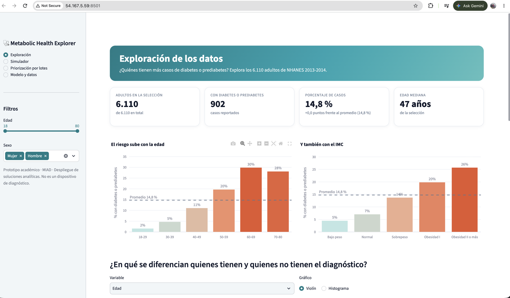
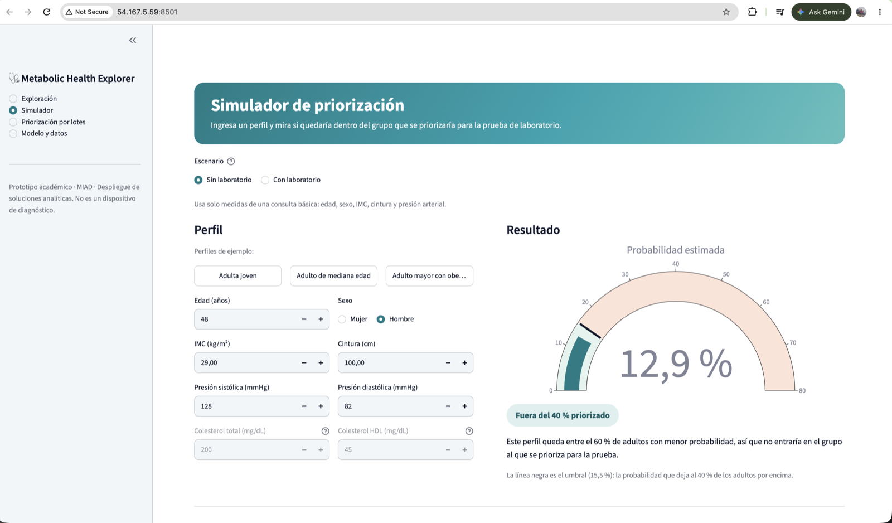
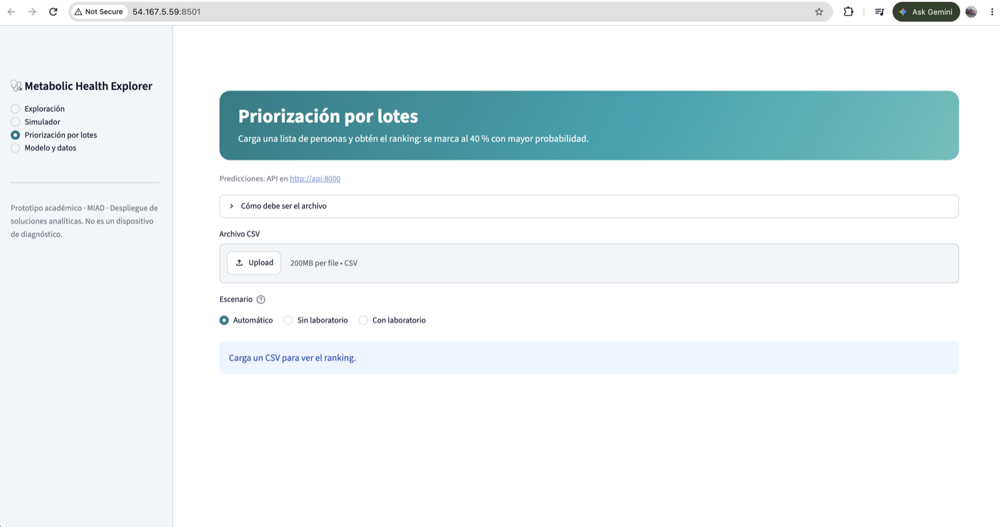
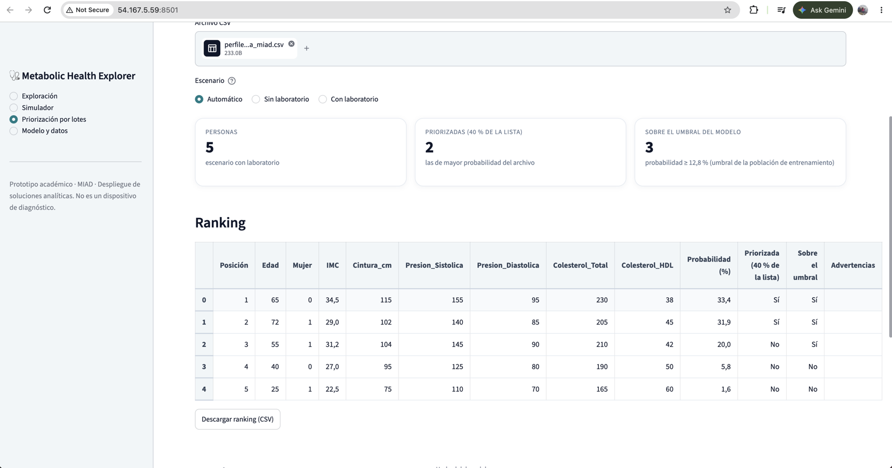
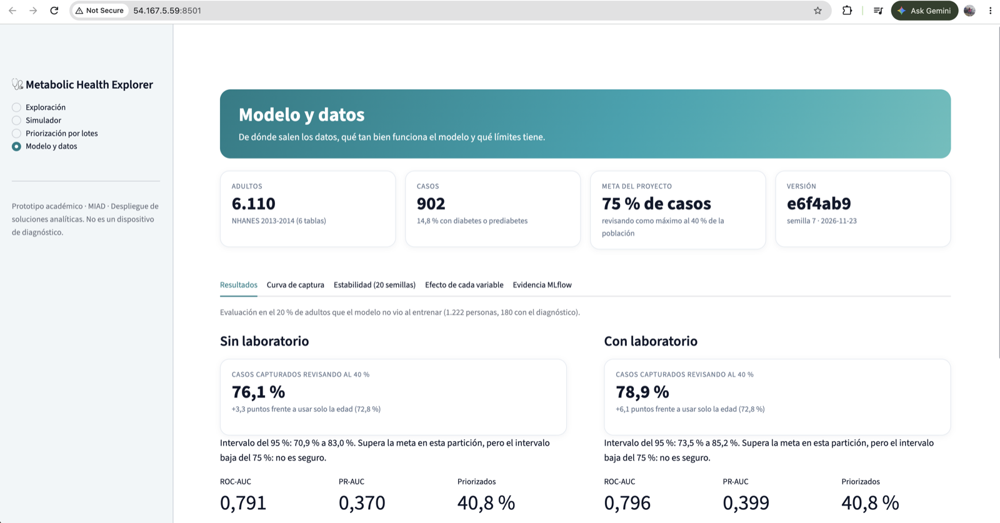

# Manual de usuario del tablero

**Producto:** Metabolic Health Explorer, prototipo MIAD - Despliegue de Soluciones Analíticas

El tablero sirve para ordenar a quién ofrecer primero una prueba de laboratorio. No es un diagnóstico, una predicción de enfermedad futura ni una herramienta de decisión médica validada.

---

## 1. ¿Para qué sirve el tablero?

Responde a la pregunta: *¿a qué adultos conviene ofrecer primero la prueba de laboratorio, si solo se puede tamizar a una parte de la población?*

El modelo estima, con medidas sencillas (edad, sexo, IMC, cintura y presión arterial), la probabilidad de que una persona tenga diabetes o prediabetes reportada. Con esa probabilidad se ordena a las personas y se marca al 40% con mayor probabilidad. La meta del proyecto es que en ese 40% quede al menos el 75 % de los casos.

Hay dos escenarios:

| Escenario | Variables | Cuándo usarlo |
|---|---|---|
| **Sin laboratorio** | Edad, sexo, IMC, cintura, presión sistólica y diastólica | Consulta básica, sin muestra de sangre. Es el escenario principal. |
| **Con laboratorio** | Las anteriores más colesterol total y colesterol HDL | Cuando ya se tiene el perfil lipídico. Rinde un poco mejor. |

## 2. Cómo entrar

1. Abra en el navegador la dirección que le entregó el equipo:
   - En la nube (AWS EC2): `http://<IP_PUBLICA>:8501`
   - En su computador (instalación local): `http://localhost:8501`
2. No requiere usuario ni contraseña.
3. Use un navegador actualizado (Chrome, Edge o Firefox). Se ve mejor en una pantalla de computador.

> La IP pública de la instancia de AWS cambia cada vez que la máquina se detiene y se vuelve a encender. Si la dirección no abre, pida la IP actual al equipo.

**Nota:** puede abrir una pantalla directamente agregando `?pantalla=` a la dirección, por ejemplo `http://<IP_PUBLICA>:8501/?pantalla=Simulador`.

## 3. Estructura general

- **Barra lateral izquierda:** menú con las cuatro pantallas. En la pantalla Exploración también aparecen los filtros.
- **Área central:** contenido de la pantalla elegida.
- Todos los gráficos son interactivos: pase el cursor para ver valores, arrastre para hacer zoom y haga doble clic para volver a la vista inicial. El ícono de cámara, arriba a la derecha de cada gráfico, descarga la imagen.

| Pantalla | Función |
|---|---|
| 1. Exploración | Ver cómo cambia el porcentaje de casos según edad, IMC y otras variables |
| 2. Simulador | Evaluar un perfil individual |
| 3. Priorización por lotes | Cargar una lista de personas y obtener el ranking |
| 4. Modelo y datos | Ver qué tan bien funciona el modelo y sus límites |

---

## 4. Pantalla Exploración

Muestra los 6.110 adultos de NHANES 2013-2014.



**Filtros:**
- **Edad:** arrastre los extremos del deslizador para elegir el rango (18 a 80 años).
- **Sexo:** deje Mujer, Hombre o ambos.

Todo el contenido de la pantalla se recalcula con los filtros.

**Qué encuentra:**

1. **Indicadores:** número de adultos en la selección, casos con diabetes o prediabetes, porcentaje de casos (y su diferencia frente al promedio general) y edad mediana.
2. **«El riesgo sube con la edad» y «Y también con el IMC»:** porcentaje de casos por grupo. La línea punteada es el promedio general.
3. **Diferencias entre quienes tienen y no tienen el diagnóstico:** elija una Variable y el tipo de Gráfico para comparar las dos clases.
4. **«Edad e IMC se refuerzan»:** mapa de calor con el porcentaje de casos para cada combinación de edad e IMC; cada celda indica cuántas personas tiene (`n`).
5. **Tabla comparativa:** medianas de cada variable en las dos clases y su diferencia. 
6. **Raza/etnia e ingreso:** solo descriptivo. Estas variables NO se usan para priorizar.

**Avisos:**
- *«Con estos filtros no queda nadie»*: amplíe el rango de edad o seleccione algún sexo.
- *«Hay solo N casos en esta selección»*: con menos de 30 casos los porcentajes son poco confiables.

---

## 5. Pantalla Simulador

Permite evaluar una persona y ver si quedaría dentro del 40 % priorizado.



**Paso a paso:**

1. Elija el **Escenario**: Sin laboratorio o Con laboratorio.
2. Cargue un perfil de ejemplo con los botones (Adulta joven, Adulto de mediana edad, Adulto mayor con obesidad) o escriba los valores:

   | Campo | Unidad | Rango permitido |
   |---|---|---|
   | Edad | años | 18 – 90 |
   | Sexo | Mujer / Hombre | — |
   | IMC | kg/m² | 12 – 70 |
   | Cintura | cm | 50 – 180 |
   | Presión sistólica | mmHg | 70 – 230 |
   | Presión diastólica | mmHg | 30 – 130 |
   | Colesterol total* | mg/dL | 70 – 400 |
   | Colesterol HDL* | mg/dL | 15 – 130 |

   \* Solo se habilitan en el escenario Con laboratorio.

3. El resultado se actualiza automáticamente; no hay botón de enviar.

**Cómo leer el resultado:**

- **Indicador:** probabilidad estimada. La línea negra es el umbral: la probabilidad que deja al 40 % de los adultos por encima. La zona verde está por debajo del umbral y la zona rosada, por encima.
- **Etiqueta:**
  - *Dentro del 40 % priorizado*: en una campaña se le ofrecería la prueba.
  - *Fuera del 40 % priorizado*: no entraría en el grupo prioritario.
- **«¿Qué empuja el resultado?»:** las barras hacia la derecha (rojo) suben la probabilidad y las barras hacia la izquierda (verde) la bajan, en comparación con una persona promedio.
- **«Tu perfil frente a los adultos de la base»:** percentil de cada valor. Un percentil 80 significa que el 80 % de los adultos tiene un valor menor.

**Aviso amarillo Valores fuera del rango habitual:** algún dato está fuera de los percentiles 1 a 99 de la base. El modelo casi no tiene personas así y el resultado es menos confiable. Revise que no sea un error de digitación.

---

## 6. Pantalla Priorización por lotes

Permite cargar una lista de personas y obtener el orden en que conviene ofrecerles la prueba.

En la parte superior se indica de dónde salen las predicciones.

### 6.1 Preparar el archivo

Un archivo CSV con una fila por persona y estas columnas (los nombres deben escribirse exactamente así):

| Columna | Obligatoria | Descripción |
|---|---|---|
| `Id` | No | Identificador para reconocer a la persona |
| `Edad` | Sí | Años (18 o más) |
| `Mujer` | Sí | 1 = mujer, 0 = hombre |
| `IMC` | Sí | kg/m² |
| `Cintura_cm` | Sí | cm |
| `Presion_Sistolica` | Sí | mmHg |
| `Presion_Diastolica` | Sí | mmHg |
| `Colesterol_Total` | No | mg/dL (escenario con laboratorio) |
| `Colesterol_HDL` | No | mg/dL (escenario con laboratorio) |

Ejemplo:

```csv
Id,Edad,Mujer,IMC,Cintura_cm,Presion_Sistolica,Presion_Diastolica
A001,62,1,33.1,108,142,84
A002,28,0,22.4,80,112,70
```

- Use punto como separador decimal y coma como separador de columnas. Si exporta desde Excel en español, revise que no quede punto y coma.
- En el desplegable «Cómo debe ser el archivo» está el botón Descargar archivo de ejemplo, que sirve como plantilla.



### 6.2 Obtener el ranking

1. Arrastre el archivo a Archivo CSV o haga clic en Browse files.
2. Elija el Escenario:
   - **Automático:** con laboratorio si todas las filas traen colesterol; sin laboratorio si ninguna lo trae.
   - **Sin laboratorio:** ignora el colesterol aunque venga en el archivo.
   - **Con laboratorio:** exige colesterol en todas las filas.
3. Revise los resultados:
   - **Indicadores:** número de personas, priorizadas (40 % de la lista) y personas sobre el umbral del modelo.
   - **Ranking:** tabla ordenada de mayor a menor probabilidad, con las columnas Posición, Probabilidad (%), Priorizada (40 % de la lista), Sobre el umbral y Advertencias. En pantalla se muestran las primeras 200 filas.
   - **Descargar ranking (CSV):** descarga la tabla completa.
   - **Histograma:** distribución de las probabilidades; la línea punteada es el umbral del modelo.



**Diferencia entre las dos marcas:**
- *Priorizada (40 % de la lista):* la persona está entre el 40 % con mayor probabilidad de este archivo. Es la marca que se usa para organizar la campaña con esa lista.
- *Sobre el umbral:* su probabilidad supera el umbral calculado con la población de entrenamiento. Sirve para comparar listas distintas con el mismo criterio.

### 6.3 Mensajes de error

| Mensaje | Qué hacer |
|---|---|
| *No se pudo leer el archivo como CSV* | Verifique que sea un CSV separado por comas y no un `.xlsx`. |
| *El archivo tiene datos que no se pueden usar* | Se listan las filas y columnas con problemas: nombres de columna mal escritos, celdas vacías, valores fuera de rango o colesterol en solo algunas filas. Corrija y vuelva a cargar. |
| *No se pudo obtener la predicción… Revisa que la API esté activa* | La API no responde. Avise al administrador (ver el manual de instalación). |

---

## 7. Pantalla «Modelo y datos»

Explica qué tan bien funciona el modelo. Los indicadores superiores muestran el número de adultos, los casos, la meta del proyecto y la versión del modelo.



| Pestaña | Qué muestra |
|---|---|
| **Resultados** | Para cada escenario: el porcentaje de casos capturados revisando al 40 % en el conjunto de prueba, la comparación con usar solo la edad, el intervalo de confianza del 95 %, ROC-AUC, PR-AUC y la tabla de priorizados y no priorizados. |
| **Curva de captura** | Qué porcentaje de los casos se encuentra según el porcentaje de adultos revisados. El cruce de las líneas negras marca la meta (75 % de los casos revisando al 40 %). Cuanto más arriba de la línea gris (solo la edad), mejor. |
| **Estabilidad (20 particiones)** | El mismo cálculo repetido con 20 particiones distintas, y la comparación entre la logística simple y los splines con interacción que justifica el modelo elegido. |
| **Efecto de cada variable** | Cuánto cambian las probabilidades (odds ratio) al pasar cada variable del percentil 25 al 75. Un valor de 1 significa que no hay efecto. Son asociaciones, no causas. |
| **Evidencia MLflow** | Capturas de los experimentos registrados en el servidor MLflow de AWS EC2. |

En el desplegable «Límites que hay que tener presentes» se resumen las restricciones del modelo.

---

## 8. Límites que debe conocer

- El modelo aprende de diagnósticos **autorreportados**: identifica el perfil de quien ya tiene un diagnóstico y no detecta la diabetes sin diagnosticar.
- Diabetes y prediabetes se tratan como una sola clase.
- El colesterol puede estar alterado por medicamentos en las personas ya diagnosticadas.
- No se usan los ponderadores muestrales de NHANES, así que los porcentajes no representan a toda la población de Estados Unidos.
- Raza/etnia e ingreso no entran al modelo, por equidad.
- Solo aplica a adultos (18 años o más).

## 9. Preguntas frecuentes

**¿Por qué el 40 %?** Es la capacidad de tamizaje que se planteó en la pregunta de negocio: con recursos para evaluar al 40 % de la población, se busca capturar al menos el 75 % de los casos.

**¿Qué escenario uso?** Sin laboratorio si solo tiene medidas de una consulta básica; Con laboratorio si ya tiene el colesterol total y el HDL de todas las personas.

**¿El resultado cambia si recargo la página?** No. Con los mismos datos, el modelo da siempre la misma probabilidad.

**¿Se guardan los datos que cargo?** No. El archivo se procesa en el momento y no se almacena.